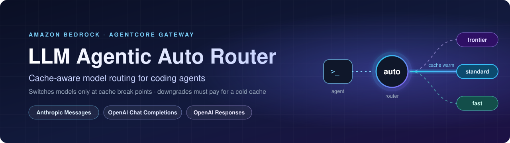
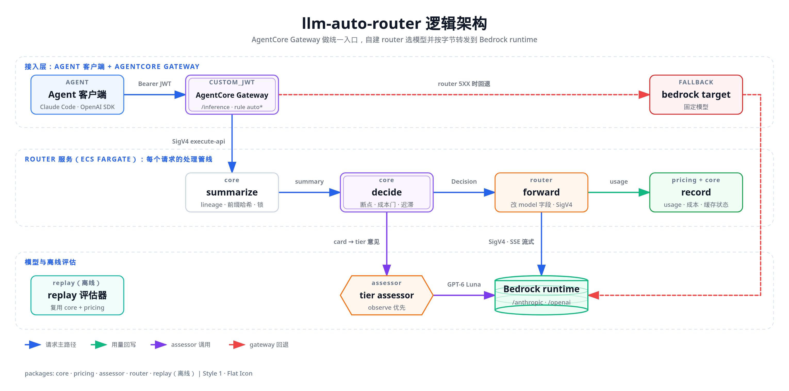

<div align="center">



<p>
  <a href="LICENSE"></a>
  
  
  
  
</p>

<p>
  <a href="#architecture"><b>Architecture</b></a> ·
  <a href="#connecting-clients"><b>Connecting clients</b></a> ·
  <a href="docs/console/README.md"><b>Console</b></a> ·
  <a href="infra/README.md"><b>Deploy</b></a> ·
  <a href="docs/experiments/harbor-summary.zh-CN.md"><b>Experiments</b></a> ·
  <a href="README.zh-CN.md"><b>简体中文</b></a>
</p>

</div>

# LLM agentic auto router

With Amazon Bedrock AgentCore Gateway as its front door, this project gives agents automatic model routing behind
Anthropic- and OpenAI-compatible APIs. It picks a model from the policy and the task, switches only at cache break
points, and can weigh the cost before a downgrade, so agents rebuild caches less often and spend less on inference. An
optional LLM assessor adds task intent. Its prompt pack and default policy were calibrated on
[Harbor experiments](docs/experiments/harbor-summary.zh-CN.md) with DeepSWE and Terminal-Bench, and on real agent
sessions. The assessor runs in observe mode by default: the system gathers evidence from routing records and nominates
candidate rules, and an admin reviews them before they are added and turned on, so routing gets more accurate with
use. Authentication, usage and cost accounting, routing decision traces and an admin console are included.

How routing works: clients send `model: auto` (or `auto:<tier>`) on the Anthropic Messages, OpenAI Chat Completions
or OpenAI Responses API. The router picks a Bedrock model per request, but switches models only at cache break
points, so an agent's prompt cache is not thrown away mid-task. Moving up is the exception: the default policy
(`userTurn: upgrade-only`) moves a conversation to a harder tier at the next user turn when the assessor, a rule, an
alias or a hint asks for one, even though that starts a new cache; it never moves down there. `userTurn: retain`
keeps a conversation on its model between break points. A policy with `userTurn: cost-gated` can also downgrade at a
user turn, when the projected saving over the next calls beats the cost of starting the cheaper model with a cold
cache. The
assessor classifies turns in observe mode by default: its verdicts are logged, not applied, unless an admin has
reviewed a rule and switched it to act.

> [!IMPORTANT]
> **This is sample code for demonstration and education. It is not production-ready as is.** Review its
> security, cost and Bedrock / API Gateway quotas against your own requirements before you deploy it in your
> account. You are responsible for the AWS costs it incurs.
>
> The stack has a **fixed cost of about USD 113/month in ap-southeast-1 while it is deployed**, even with the
> router scaled to 0 tasks (interface endpoints and the internal NLB), plus per-task, per-request and token
> charges. Other Regions differ. **Destroy the stack when you finish testing.** See
> [infra/README.md, "Cost and teardown"](infra/README.md#cost-and-teardown).

> [!TIP]
> **Deploying or upgrading? Follow the [deployment runbook](docs/deploy-runbook.md):** prerequisites, the full deploy
> context to pass on every deploy, first deployment with its security gates, routine upgrades, post-deploy checks,
> scaling, rollback and teardown.

> [!WARNING]
> **Before you deploy, raise the AgentCore Gateway payload quota from 6 MB to 10 MB.** In the AWS console, open
> **Service Quotas → AWS services → Amazon Bedrock AgentCore**, choose **Tool-call/tool-list/tool-search payload
> size** (quota code `L-603BFD8F`, default 6 MB) and request an account-level increase to **10 MB** in the Region you
> deploy to. Inference requests count as tool calls, so with the default the gateway can reject any request body over
> 6 MB before it reaches the router; long coding-agent sessions and requests with images pass that size. API Gateway
> and the router accept up to 10 MiB. See [Quotas and limits](docs/deploy-runbook.md#73-quota-increases-to-request-before-you-deploy).

## Architecture



Request path:

1. The client gets a Cognito access token (a member signs in with their own account, a service client uses client
   credentials) and calls **AgentCore Gateway** with it in `Authorization` and `x-api-key`. The gateway checks the JWT.
2. Every request goes to the router target: a **private REST API** (AWS_IAM), which the gateway calls with SigV4
   through its managed private endpoint.
3. The API forwards through a **VPC link** to an internal **NLB**, then to the router on **ECS Fargate**.
4. The router verifies the `x-api-key` token and records the caller, decides the model, rewrites only the
   top-level `model` field, SigV4-signs the call to **bedrock-runtime** over a VPC endpoint, and streams the
   response back.
5. If the router returns 5XX, cannot be reached or times out, the request fails. The gateway has no model
   fallback or direct Bedrock target: it never bypasses the router's identity checks, policy or accounting.

An optional **admin console** (a separate stack) lets admins manage members, service clients, the routing policy and
the assessor, and shows usage, list-price cost, savings and each routing decision. See
[docs/console/README.md](docs/console/README.md).

The detailed design document is in Chinese: [docs/architecture/architecture.zh-CN.md](docs/architecture/architecture.zh-CN.md).
The English design and requirement documents are indexed in [docs/README.md](docs/README.md).

## Repository layout

| Path | Contents |
|---|---|
| [packages/pricing](packages/pricing/README.md) | Versioned Bedrock price catalogs per Region and usage-cost accounting |
| [packages/core](packages/core) | The routing decision: tiers, cache break points, cost check, failover (pure, no I/O) |
| [packages/assessor](packages/assessor) | Optional LLM tier assessor, its prompt packs and offline evaluation |
| [packages/router](packages/router/README.md) | The `node:http` data-plane service behind the gateway |
| [packages/replay](packages/replay) | Offline replay of agent traces against routing policies |
| packages/console-web, console-api, console-contract, usage-ingest | The admin console: web app, API, their shared contract, and the router-log ingest ([guide](docs/console/README.md)) |
| [tools/llmar](tools/llmar/README.md) | The member sign-in CLI (`llmar login`, `llmar-token`) |
| [infra](infra/README.md) | CDK app (TypeScript) for the gateway, private API, NLB, Fargate router and VPC |
| [spikes](spikes) | Verification experiments: gateway front door (V0–V8) and router hop options (V9 Lattice, V9d private REST API) |
| [docs](docs/README.md) | Architecture, design documents and research notes |

## Prerequisites and quick start

- Node.js 24 or later.
- pnpm through Corepack (`corepack enable`). The version is pinned in `package.json`.

```bash
corepack enable
pnpm install --frozen-lockfile
pnpm -r typecheck && pnpm -r test
```

The tests need no AWS account: the router's integration tests use a local fake Bedrock.

To deploy, follow the [deployment runbook](docs/deploy-runbook.md); every deploy input is described in
[infra/README.md](infra/README.md). Region and account are explicit deploy parameters; nothing falls back to your
shell's Region:

```bash
cd infra && npx cdk deploy -c region=<aws-region> -c account=<account-id> -c prefix=<unique-prefix> ...
```

The Region needs a price catalog: one is bundled for `ap-northeast-1`, `ap-southeast-1` and `us-west-2`, or you can
capture one for another Region (see [packages/pricing/README.md](packages/pricing/README.md)). The shipped default
policy runs in observe mode: it logs the decisions it would make and serves `auto` requests with a fixed model.

## Connecting clients

Clients talk to the AgentCore Gateway with the provider's own API, the Anthropic Messages or the OpenAI Chat
Completions / Responses API. Nothing else in the client changes. There are two kinds of callers:

- **Members** (people) sign in with their own Cognito account through the `llmar` CLI. This is the normal path.
  The [admin console](docs/console/README.md)'s Get started page shows the same steps with this deployment's values.
- **Service clients** (CI jobs, agents) use the client-credentials flow with a client secret.

Both send their Cognito access token **twice**: as `Authorization: Bearer <token>` and as `x-api-key: <token>`.
The gateway authenticates the `Authorization` header. The router verifies the `x-api-key` copy and records who made
the call, so usage, cost and decisions are per caller. Client-asserted headers are never used as identity.

### What you need from the deployment

| Item | Where it comes from |
|---|---|
| Gateway URL | stack output `GatewayUrl`, e.g. `https://<gw-id>.gateway.bedrock-agentcore.<region>.amazonaws.com` |
| Console URL | console stack output `ConsoleUrl` (see [infra/README.md](infra/README.md#admin-console-console-stack)) |
| Member settings | the `llmar configure` block on the console's Get started page |
| Service client id and secret | the console's Service clients page (the secret is shown once) |
| Scope | `<prefix>/invoke` (`llmar/invoke` with the default prefix) |

### Endpoints, models and headers

| API | URL | SDK base URL |
|---|---|---|
| Anthropic Messages | `<GatewayUrl>/inference/v1/messages` | `<GatewayUrl>/inference` (the SDK appends `/v1/messages`) |
| OpenAI Chat Completions | `<GatewayUrl>/inference/v1/chat/completions` | `<GatewayUrl>/inference/v1` |
| OpenAI Responses | `<GatewayUrl>/inference/v1/responses` | `<GatewayUrl>/inference/v1` |

- **Model.** Send `model: "auto"`, or `auto:fast` / `auto:standard` / `auto:frontier` to ask for a tier. Every
  model name goes to the router. A concrete Bedrock model id is treated as a pin: it is served if it is in the
  router's policy and within your tier limit, otherwise the request gets 400 (`pin-not-allowed` or `access-cap`).
- **Auth.** `Authorization: Bearer <access token>` and `x-api-key: <access token>`. Member and
  service-client tokens last 60 minutes. The `llmar` CLI refreshes member tokens for you.
- **Identity mode.** The router runs in `off`, `observe` or `require` mode (an admin setting). In `observe`, blocks,
  budgets and tier limits apply to every call that carries a valid `x-api-key`; a call without one is served
  unattributed and escapes them. In `require`, such a call gets 401, so they bind everyone.
- **Optional request headers.** The gateway forwards only these: `x-api-key`, `x-router-session`,
  `x-router-parent-session`, `x-router-agent-id`, `x-router-hint`, `x-claude-code-session-id`, `x-session-id`,
  `anthropic-version`, `anthropic-beta` and `openai-beta`.
  - `x-router-session: <id>` keeps one agent session on one lineage. Cache-aware routing depends on it. Use one
    stable id per agent session, never a shared constant. Claude Code's own `x-claude-code-session-id` is read
    the same way. Codex needs no session header: the router reads Codex's own session id from the request body,
    ahead of this header.
  - `x-router-hint: pin=<model id>` serves that model. `x-router-hint: tier=frontier` asks for a tier. Combine
    several keys with `;`.
- **Response headers:** `x-router-decision`, `x-router-model` (the model that served the call) and `x-router-reason`.
- **Observe mode (the shipped default policy).** Every `auto*` request is served by the policy's observe default:
  Sonnet 5.5 on Messages, GPT-6.1 Sol on Chat and Responses. The decision the router *would* make is only logged.
  Tier aliases and `tier=` hints take effect only with a policy in `auto` mode. Pins work in both modes.

### Members: sign in with `llmar`

`llmar` is one Python 3.9+ file with no dependencies outside the standard library ([tools/llmar](tools/llmar/README.md)).
The commands below are for macOS and Linux; for Windows, see [Windows](#windows).

```bash
mkdir -p ~/bin
curl -fsSLo ~/bin/llmar <raw URL of tools/llmar/llmar> && chmod +x ~/bin/llmar
ln -sf llmar ~/bin/llmar-token && ln -sf llmar ~/bin/llmar-login
llmar configure --from '<JSON block from the console Get started page>'
llmar login      # browser sign-in with your password
llmar status     # who you are and when the token expires
```

- **No console?** Build the `configure` block from the router stack outputs: `{"cognitoDomain": "<TokenEndpoint
  without /oauth2/token>", "clientId": "<CliClientId>", "scope": "<prefix>/invoke", "redirectPorts": [52817, 52818,
  52819], "gatewayUrl": "<GatewayUrl>"}` (the ports are the `cliRedirectPorts` deploy value).
- `llmar-token` prints a valid access token and nothing else. It answers from its cache and refreshes the token 5
  minutes before it expires. Claude Code, Codex and your code call it.
- On a machine without a browser (SSH), run `llmar login --no-browser`. It prints the link and an `ssh -L` command
  for the callback port.
- The sign-in lasts 30 days. Sign in again after that, after "Sign out everywhere", or after an admin re-enabled
  your account.
- If the sign-in service is unreachable but the cached token has more than 30 seconds left, `llmar-token` prints it
  (exit 0) with a warning on stderr. Otherwise its exit codes are: 2 = sign in again (`run llmar login`): the
  sign-in expired or was revoked, or the settings changed (`llmar configure`) since sign-in; 3 = the sign-in service
  is unreachable and no usable cached token is left; 4 = a setup problem: missing settings, a credentials file
  other users can read, the `llmar` directory or its parent writable by others, or bad usage.

### Claude Code

In `~/.claude/settings.json`, or a project's `.claude/settings.json`:

```json
{
  "apiKeyHelper": "~/bin/llmar-token",
  "env": {
    "ANTHROPIC_BASE_URL": "https://<gw-id>.gateway.bedrock-agentcore.<region>.amazonaws.com/inference",
    "CLAUDE_CODE_USE_BEDROCK": "0",
    "ANTHROPIC_MODEL": "auto",
    "ANTHROPIC_DEFAULT_OPUS_MODEL": "auto:frontier",
    "ANTHROPIC_DEFAULT_SONNET_MODEL": "auto:standard",
    "ANTHROPIC_DEFAULT_HAIKU_MODEL": "auto:fast",
    "CLAUDE_CODE_MAX_CONTEXT_TOKENS": "1000000",
    "CLAUDE_CODE_API_KEY_HELPER_TTL_MS": "240000",
    "CLAUDE_CODE_DISABLE_NONESSENTIAL_TRAFFIC": "1"
  }
}
```

- **Tokens.** Claude Code sends the helper's output both as a bearer token and as `X-Api-Key`, so no extra setting
  is needed. The 4-minute TTL makes it ask `llmar-token` often; `llmar` answers from its cache. Claude Code can
  keep using a cached token past the TTL while it refreshes in the background. If the gateway refuses it (an expired
  token gets 403 `insufficient_scope`), Claude Code asks again, and `llmar` hands out a new token.
- **Choosing a tier.** The alias variables make `/model opus|sonnet|haiku` ask the router for a tier rather than a
  fixed model.
- **Context window.** Claude Code does not know the name `auto` and would assume a 200K window, compacting the
  conversation there. `CLAUDE_CODE_MAX_CONTEXT_TOKENS` gives it the 1M window of the router's Claude models.
- **Request compatibility.** Claude Code's session header is forwarded, and its JSON `metadata.user_id` and the
  `advanced-tool-use` beta, which Bedrock rejects, are normalised by the router.
- **Token counting.** The gateway does not expose `/v1/messages/count_tokens`. Claude Code gets a 404 and falls
  back to its own estimate.
- **Refusal fallback.** If the served model refuses on safety grounds, Claude Code 2.1 may retry with its built-in
  fallback model, for example `claude-opus-4-8`. That id is not in the router's policy, so the retry gets 400. See
  [docs/experiments/claude-code-harbor.zh-CN.md](docs/experiments/claude-code-harbor.zh-CN.md) §5.1.

### Claude Desktop

Claude Desktop on third-party inference, with the gateway provider. Turn on Help → Troubleshooting → Enable Developer
Mode, open Developer → Configure Third-Party Inference…, and load this block, saved as a `.json` file, with
**Import configuration…** (or enter the same values in the form). Then Apply Changes and relaunch.

```json
{
  "inferenceProvider": "gateway",
  "inferenceGatewayBaseUrl": "https://<gw-id>.gateway.bedrock-agentcore.<region>.amazonaws.com/inference",
  "inferenceGatewayAuthScheme": "bearer",
  "inferenceCredentialHelper": "<home>/bin/llmar",
  "inferenceCredentialHelperArgs": ["credential"],
  "inferenceCredentialHelperTtlSec": 240,
  "inferenceModels": [
    { "name": "claude-auto", "behavesAs": "claude-sonnet-5-5" },
    { "name": "claude-opus-auto", "behavesAs": "claude-opus-5-5", "anthropicFamilyTier": "opus" },
    { "name": "claude-sonnet-auto", "behavesAs": "claude-sonnet-5-5", "anthropicFamilyTier": "sonnet" },
    { "name": "claude-haiku-auto", "behavesAs": "claude-haiku-5-5", "anthropicFamilyTier": "haiku" }
  ]
}
```

- **Helper path.** Claude Desktop expands neither `~` nor `%USERPROFILE%`: write `<home>` out in full, for example
  `/Users/alice/bin/llmar`. On Windows use `C:\\Users\\alice\\bin\\llmar.cmd` (JSON escapes the backslashes).
- **Tokens.** `llmar credential` prints `{"token": …, "headers": {"x-api-key": …}}`. Claude Desktop sends the token as
  the bearer token, which the gateway checks, and adds the header, which the router identifies the caller by. A plain
  API key in the form would get 401 after the access token's hour. With the TTL above 120 s, Claude Desktop checks the
  credential before each turn; `llmar` answers from its cache and refreshes before expiry.
- **Aliases.** Claude Desktop's model list refuses ids that do not look like Claude ("Doesn't look like an Anthropic
  model" for `auto:frontier`), so the router policy needs four more aliases. An admin adds them under Routing policy →
  Aliases: `claude-auto` → default, `claude-opus-auto` → frontier, `claude-sonnet-auto` → standard,
  `claude-haiku-auto` → fast. The Get started page warns when they are missing.
- **Models.** The gateway's `GET /inference/v1/models` returns an empty list, so the aliases are listed. `behavesAs` (Claude Desktop 4.29.0 or later) gives each alias
  a Claude model's effort levels and context window; `anthropicFamilyTier` sends Claude Desktop's own `opus`, `sonnet`
  and `haiku` requests, from sub-agents for example, to the matching tier.

### Codex

Codex cannot send one refreshing token in two headers. For sessions of any length, it uses two sign-ins: `llmar`
for `Authorization`, and Codex's own browser sign-in for `x-api-key`.

First create a model catalog that gives `auto` a context window. Codex does not know `auto` and caps an unknown
model at 272K, whatever `model_context_window` says (sessions then compact at about 258K). The file is the catalog
shipped with Codex plus `auto`, a copy of GPT-6.1 Sol with Bedrock's 1M window. If your Codex version does not ship
GPT-6.1 Sol, the command copies another Sol or the catalog's first model, and prints which one it copied:

```sh
codex debug models --bundled | python3 -c 'import copy, json, sys
d = json.load(sys.stdin)
ms = d["models"]
pick = [m for s in ("gpt-6.1-sol", "gpt-6.2-sol", "gpt-6-sol") for m in ms if m["slug"] == s]
a = copy.deepcopy((pick or sorted(ms, key=lambda m: m.get("priority") or 99))[0])
print("auto copies", a["slug"], file=sys.stderr)
a.update(slug="auto", display_name="auto (llmar)", description="Routed by llmar", priority=0,
         upgrade=None, availability_nux=None, context_window=1000000, max_context_window=1000000)
d["models"].insert(0, a)
json.dump(d, sys.stdout)' > ~/.codex/llmar-models.json
```

Then, in `~/.codex/config.toml`:

```toml
model = "auto"
model_provider = "llmar"
model_catalog_json = "/home/<you>/.codex/llmar-models.json" # created by the command above
model_context_window = 1000000         # needs the catalog: without it Codex caps "auto" at 272K
model_auto_compact_token_limit = 700000
web_search = "disabled"                # required: Bedrock rejects Codex's built-in web search tool mid-stream

[model_providers.llmar]
name = "llmar router"
base_url = "https://<gw-id>.gateway.bedrock-agentcore.<region>.amazonaws.com/inference/v1"
wire_api = "responses"
requires_openai_auth = false
supports_websockets = false

[model_providers.llmar.auth]           # Authorization: Bearer, refreshed by llmar
command = "/home/<you>/bin/llmar-token" # a resolved absolute path, as the Codex docs ask
timeout_ms = 15000
refresh_interval_ms = 240000

[model_providers.llmar.gateway_oauth]  # Codex's own sign-in; its token goes in x-api-key
authorization_url = "https://<domain>.auth.<region>.amazoncognito.com/oauth2/authorize"
token_url = "https://<domain>.auth.<region>.amazoncognito.com/oauth2/token"
client_id = "<cli client id>"
scopes = ["openid", "<prefix>/invoke"]
redirect_port = 52820                  # the port registered for Codex on the cli app client
delivery = { kind = "header", name = "x-api-key" }
# credentials_store = "file"           # headless Linux without a keyring: keep this sign-in in $CODEX_HOME/secrets/

[memories]                             # background memory passes name their own model: keep them on the router
extract_model = "auto:fast"
consolidation_model = "auto:fast"

[features]
enable_request_compression = false     # the gateway/router path takes identity-encoded JSON
```

Then run `codex`. Codex opens its own sign-in page once.

- **Over SSH**, Codex's own sign-in needs its callback port forwarded too:
  `ssh -L 52820:127.0.0.1:52820 <host>`. Codex prints the sign-in URL; open it on
  your own computer.
- **Headless Linux without a keyring.** Codex stores its sign-in in the OS keyring by default. Add
  `credentials_store = "file"` to the `gateway_oauth` table to keep it in `$CODEX_HOME/secrets/gateway_oauth.json`
  instead (mode 0600, plain text).
- **Short sessions (under 60 minutes)** can skip the second sign-in. Leave out the `auth` and `gateway_oauth`
  tables, set `env_key = "LLMAR_TOKEN"` and
  `env_http_headers = { "x-api-key" = "LLMAR_TOKEN" }`, and run `LLMAR_TOKEN=$(llmar-token) codex`. Codex reads
  the token once at start.
- **Sessions.** Codex names each conversation itself, and the router keys its routing state on that id. A
  conversation started with `/new` is a new router session. `codex resume` continues the old one. A sub-agent Codex
  spawns gets its own lineage in its parent's session. Older configs that still map
  `x-router-session = "LLMAR_SESSION"` keep working, and Codex's own id still wins over the header.
- **Thread titles.** The TUI asks for a thread title at the start of each session. The router recognizes that
  request and routes it on its own: fast tier, a session of its own. So it does not touch your session's model or
  cache. In the console it is listed as a session of its own, labelled "Thread title" on the Decisions page.
- **Web search must be off.** With Codex's default web search tool in the request, Bedrock ends every stream with
  "web search is not supported for this request". Codex then reports "stream disconnected before
  response.completed" and retries until it gives up.
- **Model catalog.** `model_catalog_json` replaces Codex's catalog instead of adding to it, so the file keeps every
  bundled model. It is a snapshot: run the command again after you upgrade Codex (`--bundled` reads the catalog
  shipped with the binary, not the file). Codex reads it at startup. The router does not serve this catalog; each
  user creates the file.
- **`Model metadata for 'auto' not found`** means Codex is not reading the catalog: check the `model_catalog_json`
  path. The session then runs with a 272K window.
- **Context window.** 1,000,000 is the smallest window among the routed GPT models (GPT-6.1 Sol; Astra and Luna
  have 1.05M). Codex uses 95% of it (950,000). If an admin adds a model with a smaller window to the Responses pool,
  lower `max_context_window` of `auto` in the command to match. Prompts above 272k tokens are billed at the
  long-context rate, so lower `model_context_window` and `model_auto_compact_token_limit` if you want to stay under
  that step.
- **"auth command exited with status 2".** Codex does not show why. Run `llmar-token` in a terminal: usually you
  need to run `llmar login` again.

### Windows

**WSL.** Inside WSL, Claude Code and Codex are Linux programs: follow the sections above as written, in the WSL
shell. Two things differ:

- `llmar login` and Codex's own sign-in print a sign-in URL. If no browser opens, open the URL in your Windows
  browser. WSL 2 passes the `127.0.0.1` callback on to WSL (localhost forwarding, on by default).
- WSL has no keyring unless you installed one, so add `credentials_store = "file"` to the Codex `gateway_oauth`
  table (see "Headless Linux without a keyring" above).

**Native Windows (PowerShell).** The steps are the same; the commands and the paths differ. `llmar` needs Python
3.9 or later: `python --version` must print a version. The tests listed [below](#service-clients-ci-and-agents) ran
on Linux; these steps follow how Claude Code and Codex document helper commands on Windows.

Install `llmar`. Windows does not run a script by its first line, and symlinks need extra rights, so three `.cmd`
files give it the names `llmar`, `llmar-token` and `llmar-login`:

```powershell
$bin = "$HOME\bin"
New-Item -ItemType Directory -Force $bin | Out-Null
curl.exe -fsSLo "$bin\llmar" '<raw URL of tools/llmar/llmar>'
Set-Content "$bin\llmar.cmd"       '@python "%~dp0llmar" %*'
Set-Content "$bin\llmar-token.cmd" '@python "%~dp0llmar" token %*'
Set-Content "$bin\llmar-login.cmd" '@python "%~dp0llmar" login %*'
$userPath = [Environment]::GetEnvironmentVariable('Path', 'User')   # add the folder to your PATH, once
if (($userPath -split ';') -notcontains $bin) { [Environment]::SetEnvironmentVariable('Path', "$userPath;$bin", 'User'); $env:Path += ";$bin" }
```

Configure it and sign in. The block goes in on standard input, because PowerShell changes the double quotes of a
JSON argument on its way to a `.cmd` file:

```powershell
@'
<JSON block from the console Get started page>
'@ | llmar configure --from -
llmar login      # browser sign-in with your password
llmar status     # who you are and when the token expires
```

The settings and the sign-in are kept in `%USERPROFILE%\.config\llmar`. `llmar` does not check Windows
permissions; it relies on your user profile being yours alone, which is the Windows default.

**Claude Code** reads `%USERPROFILE%\.claude\settings.json`. Use the settings from [Claude Code](#claude-code) with
this helper line:

```json
  "apiKeyHelper": "\"%USERPROFILE%\\bin\\llmar-token.cmd\"",
```

On Windows, Claude Code runs `apiKeyHelper` through `cmd`, which fills in `%USERPROFILE%`. Keep the inner quotes:
they hold a profile folder with spaces in its name together.

**Codex** reads `%USERPROFILE%\.codex\config.toml`. Create the model catalog first. Python runs Codex and writes
the file itself, because a PowerShell pipe or `>` would re-encode the JSON:

```powershell
python -c @'
import copy, json, subprocess
from pathlib import Path
d = json.loads(subprocess.run('codex debug models --bundled', shell=True, capture_output=True, check=True).stdout)
ms = d['models']
pick = [m for s in ('gpt-6.1-sol', 'gpt-6.2-sol', 'gpt-6-sol') for m in ms if m['slug'] == s]
a = copy.deepcopy((pick or sorted(ms, key=lambda m: m.get('priority') or 99))[0])
print('auto copies', a['slug'])
a.update(slug='auto', display_name='auto (llmar)', description='Routed by llmar', priority=0,
         upgrade=None, availability_nux=None, context_window=1000000, max_context_window=1000000)
d['models'].insert(0, a)
out = Path.home() / '.codex' / 'llmar-models.json'
out.parent.mkdir(exist_ok=True)
out.write_text(json.dumps(d), encoding='utf-8')
'@
```

Then use the configuration from [Codex](#codex) with these two lines, and leave out the `credentials_store`
comment. Single quotes make TOML literal strings, which keep the backslashes as they are. Save the file as UTF-8:

```toml
model_catalog_json = '%USERPROFILE%\.codex\llmar-models.json' # created by the command above; must be a full path (next command)

[model_providers.llmar.auth]           # Authorization: Bearer, refreshed by llmar
command = '%USERPROFILE%\bin\llmar-token.cmd' # must be a full path: the next command writes your profile folder here
```

**Required:** Codex does not fill in `%USERPROFILE%` (or any variable) in `config.toml`, so the two paths do not work
as saved: Codex finds neither the catalog nor `llmar-token.cmd`. After saving the configuration, run this once to
write your profile folder in its place:

```powershell
python -c @'
from pathlib import Path
p = Path.home() / '.codex' / 'config.toml'
p.write_text(p.read_text(encoding='utf-8').replace('%USERPROFILE%', str(Path.home())), encoding='utf-8')
'@
```

Then run `codex`. Codex opens its own sign-in page once.

- **Short sessions (under 60 minutes)** work as described under [Codex](#codex); run
  `$env:LLMAR_TOKEN = llmar-token; codex`.
- **"python is not recognized", or the Microsoft Store opens.** Python is not installed, or it is not on your
  PATH. Install Python 3.9 or later from python.org or the Microsoft Store and open a new PowerShell window. If only
  the `py` launcher works on your machine, replace `python` with `py -3` in the three `.cmd` files.
- **Environment variables.** The FAQ's checks in PowerShell:
  `Get-ChildItem Env: | Where-Object Name -match 'CLAUDE_CODE_USE_BEDROCK|ANTHROPIC_API_KEY|ANTHROPIC_BASE_URL'`
  shows what is set, `Remove-Item Env:ANTHROPIC_API_KEY` unsets a variable in this window, and
  `llmar-token > $null` shows whether `llmar login` is needed.
- **From code**, name the helper with its extension: `subprocess.run(['llmar-token.cmd'], …)`. Python does not try
  `.cmd` for a bare name.

### From code

Both SDKs take an `httpx` auth hook that sets both headers on every request, so a long-running process never sends
an expired token:

```python
import subprocess, uuid
import anthropic, openai
import httpx2 as httpx   # anthropic>=2 / openai>=3 ship httpx2; older releases use httpx

GW = 'https://<gw-id>.gateway.bedrock-agentcore.<region>.amazonaws.com'

def router_token() -> str:   # llmar answers from its cache and refreshes 5 min before expiry
    return subprocess.run(['llmar-token'], capture_output=True, text=True, check=True).stdout.strip()

class RouterAuth(httpx.Auth):
    def auth_flow(self, request):
        t = router_token()
        request.headers['authorization'] = f'Bearer {t}'
        request.headers['x-api-key'] = t
        yield request

session = {'x-router-session': str(uuid.uuid4())}   # one id per agent session
claude = anthropic.Anthropic(base_url=f'{GW}/inference', auth_token='unused', default_headers=session,
                             http_client=httpx.Client(auth=RouterAuth()))
oai = openai.OpenAI(base_url=f'{GW}/inference/v1', api_key='unused', default_headers=session,
                    http_client=httpx.Client(auth=RouterAuth()))

msg = claude.messages.create(model='auto', max_tokens=512, messages=[{'role': 'user', 'content': 'Hello'}])
chat = oai.chat.completions.create(model='auto', messages=[{'role': 'user', 'content': 'Hello'}])
resp = oai.responses.create(model='auto', input='Hello', store=False)
```

```bash
TOKEN=$(llmar-token)
curl -sS "$GW/inference/v1/messages" -H "Authorization: Bearer $TOKEN" -H "x-api-key: $TOKEN" \
  -H 'content-type: application/json' -H 'anthropic-version: 2023-06-01' -H "x-router-session: $(uuidgen)" \
  -d '{"model": "auto", "max_tokens": 256, "messages": [{"role": "user", "content": "Say ok."}]}' -D -
```

To read the routing decision, use `with_raw_response` (`claude.messages.with_raw_response.create(...)`, then
`.headers['x-router-model']`). Streaming works on all three APIs with the SDKs' usual calls (`messages.stream(...)`,
`stream=True`).

### Service clients (CI and agents)

An admin creates a service client on the console's Service clients page and copies the secret, which is shown once.
Keep the client id, secret and token endpoint in a Secrets Manager secret that only that job can read, for example a
JSON string `{"client_id": …, "client_secret": …, "token_url": …}`. Do not put the secret in config files. Budgets
and tier limits apply to service clients as they do to members.

This helper prints a client-credentials access token. Save it as `~/bin/llmar-m2m-token` (its own name, so it does
not clash with the member CLI) and `chmod +x` it:

```python
#!/usr/bin/env python3
# llmar-m2m-token: print a Cognito access token for a service client (needs boto3 and read access to the secret).
import base64, json, os, urllib.parse, urllib.request
import boto3

s = json.loads(boto3.client('secretsmanager').get_secret_value(SecretId=os.environ.get('LLMAR_SECRET_ID', 'llmar/client'))['SecretString'])
basic = base64.b64encode(f"{s['client_id']}:{s['client_secret']}".encode()).decode()
data = urllib.parse.urlencode({'grant_type': 'client_credentials', 'scope': os.environ.get('LLMAR_SCOPE', 'llmar/invoke')}).encode()
req = urllib.request.Request(s['token_url'], data=data, headers={'Authorization': f'Basic {basic}',
                             'Content-Type': 'application/x-www-form-urlencoded'})
with urllib.request.urlopen(req, timeout=30) as r:
    print(json.load(r)['access_token'])
```

Send its token in both headers, exactly as above (`router_token()` can call `llmar-m2m-token` instead). Each call
mints a new token, which Cognito bills per token: a long-running job should cache it for up to 60 minutes.

> **Tested on 2026-11-08**, in two runs against a deployed stack with the shipped observe policy:
> - **Clients, before identity was added:** curl on all three endpoints; the Anthropic and OpenAI Python SDKs,
>   streaming and non-streaming; Claude Code 2.1.318, including multi-turn tool use and `--model opus` arriving as
>   `auto:frontier`; Codex 0.167, including a shell tool call. Every `auto*` call was served by the observe default,
>   `pin=` was honoured and an unknown pin got 400.
> - **End to end with identity and the console** (ap-southeast-1): a service client with both headers; a member invited, then
>   `llmar configure` and `llmar login`, calls on all three APIs, Claude Code with `apiKeyHelper` and Codex with
>   `auth.command` plus `x-api-key`, all attributed to the member; a concrete model id served as a pin. Requests
>   with no token or a bad token got 401. In `require` mode a call without `x-api-key` got 401 `identity-missing`,
>   a disabled member got 403 `identity-blocked`, and a member over a hard-stop budget got 429 `budget-exceeded`.

### FAQ

- **Claude Code shows "Amazon Bedrock" in its header, or "The provided model identifier is invalid".** Claude Code
  is calling Bedrock directly: `CLAUDE_CODE_USE_BEDROCK` is set in your environment or another settings file, and it
  wins over `ANTHROPIC_BASE_URL`. Keep `"CLAUDE_CODE_USE_BEDROCK": "0"` in the router settings and restart Claude
  Code. `env | grep -E 'CLAUDE_CODE_USE_BEDROCK|ANTHROPIC_API_KEY|ANTHROPIC_BASE_URL'` shows what is set.
- **Claude Code warns "Both apiKeyHelper and ANTHROPIC_API_KEY set", or the console counts your requests as
  unattributed.** Claude Code still signs in to the gateway with your `llmar` token, but it sends the
  `ANTHROPIC_API_KEY` value in `x-api-key`, the header the router reads your identity from (an `x-api-key` in
  `ANTHROPIC_CUSTOM_HEADERS` does the same). Requests work but are unattributed: your tier limit and budget do not
  apply, and identity `require` answers them with 401 `identity-malformed`. `unset ANTHROPIC_API_KEY` for router
  sessions and remove it from your settings files.
- **Claude Code: `Model "auto" isn't recognized · context assumed to be 200k tokens`.** Claude Code does not know
  the router's alias, so it assumes a 200K window and compacts the conversation at 200K. The router's Claude models
  have a 1M window: keep `"CLAUDE_CODE_MAX_CONTEXT_TOKENS": "1000000"` in the router settings and restart Claude
  Code. Use a smaller value only if your admin limits you to a model with a smaller window.
- **Claude Code: `Please run /login · API Error: 403 insufficient_scope` in the middle of a session.** Not a
  permission problem, and not an Anthropic sign-in: the AgentCore gateway answers an expired access token with 403
  `insufficient_scope` (not 401). Don't run `/login`; send the prompt again. Claude Code asks `llmar-token` again
  after the 403, and `llmar` hands out a new token when the same token is asked for again within a minute. If it
  keeps happening, run `llmar-token > /dev/null` to see whether `llmar login` is needed, and check the clock
  (`date -u`).
- **`llmar configure` says "… is writable by others without the sticky bit".** Ubuntu's default umask makes
  `~/.config` group-writable. Current `llmar` accepts that when the group is your own private group; with an older
  copy run `chmod g-w ~/.config`, or set `LLMAR_CONFIG_DIR` (for Claude Code and Codex too).
- **What goes in Codex's `redirect_port`?** The port registered for Codex's own sign-in on the `cli` app client
  (`codexOauthPort`, default 52820). The console's Get started page fills it in.
- **Codex: "Gateway sign-in required or unavailable" right after signing in.** Codex could not store its sign-in:
  Linux without a keyring (servers, SSH sessions). Uncomment `credentials_store = "file"` in the `gateway_oauth`
  table, start Codex and sign in again.
- **Signing in on a remote machine over SSH.** Both sign-ins return to `127.0.0.1` on the machine that runs the tool.
  Forward the callback ports, `ssh -L 52817:127.0.0.1:52817 -L 52820:127.0.0.1:52820 <host>`, and open the
  printed URL on your own computer (`llmar login --no-browser` prints it).
- **Why `/home/<you>/bin/llmar-token`?** Codex does not expand `~`. After saving the config you can run
  `sed -i "s#/home/<you>#$HOME#" ~/.codex/config.toml`.
- **Codex: "auth command exited with status 2".** `llmar` has no valid sign-in. Run `llmar-token` in a terminal to
  see why; usually `llmar login` again (after the refresh-token lifetime, or after an admin disabled and re-enabled
  you).
- **My OpenAI-compatible client sends `max_tokens`.** That works: GPT models on Bedrock reject `max_tokens`, so the
  router renames it to `max_completion_tokens` when a GPT model serves the request. Other models are unchanged.
- **Function tools on Chat Completions.** GPT models on Bedrock reject Chat Completions requests that carry function
  tools unless `reasoning_effort` is `none`. When a GPT model serves such a request and it has no `reasoning_effort`,
  the router adds `"reasoning_effort": "none"`. A `reasoning_effort` you send is kept as sent, so any other value
  with function tools gets Bedrock's 400 when a GPT model serves it; use Responses for tools with reasoning.
- **Service tier (`service_tier`).** On Chat Completions and Responses, the router adds the model's default Bedrock
  service tier when your request has no `service_tier`: `flex` for Kimi and GLM models, which some accounts can only
  call on flex. A `service_tier` you send is kept as sent. Cost is priced at the tier the response reports. Admins
  set the default per model on the Models page.
- **Which model answered?** Every response carries `x-router-model` and `x-router-decision`; the console's Decisions
  page lists each request with its basis.
- **`Model metadata for 'auto' not found` (Codex).** Codex is not reading `~/.codex/llmar-models.json`, so it caps
  `auto` at 272K. Create the file and check the `model_catalog_json` path (see [Codex](#codex)).
- **Codex: 400 `pin-not-allowed` on the Decisions page while the session works.** Some Codex background passes name
  a model of their own instead of `auto`, such as memory extraction at startup (`gpt-6-luna`). The router refuses a
  name that is neither an alias nor an allowed model, so only that pass fails. Keep the `[memories]` table in
  `config.toml` (it is in the snippet above), or set `generate_memories = false` there to turn memories off. An admin
  can instead add the name as an alias on the Routing policy page.

## Performance

Load tests on 2026-11-23 and 11-24 sent short streamed OpenAI Chat Completions requests (`model: auto:fast`, served by
`global.openai.gpt-6-luna`) from 4 client processes to the us-west-2 deployment, first with one router task
(1 vCPU / 2 GiB, ARM64), then with two tasks and CPU autoscaling. Full report (Chinese):
[docs/experiments/router-loadtest.zh-CN.md](docs/experiments/router-loadtest.zh-CN.md).

| Tasks | Concurrency | Success | Throughput | End-to-end p50 / p99 | Router overhead p50 / p99 | CPU per task |
|---|---|---|---|---|---|---|
| 1 | 20 | 100% | 38 RPS | 511 / 854 ms | 6 / 13 ms | 21% |
| 1 | 50 | 99.98% | 100 RPS | 479 / 786 ms | 6 / 54 ms | 47% |
| 1 | 100 (before throttling) | 100% | 184 RPS | 508 / 892 ms | 13 / 224 ms | 85% |
| 2 | 50 | 99.99% | 194 RPS | 242 / 489 ms | 6 / 100 ms | 46% |
| 2 | 100 | 77% (gateway 429) | 171 RPS | 246 / 589 ms | 7 / 228 ms | 44% |

(The second day's requests allowed 8 output tokens instead of 64, so their end-to-end times are shorter.)

- **The ceiling of the whole path is AgentCore Gateway's request rate, about 200 requests/s.** The gateway counts
  inference requests as tool calls, and the default is 200 TPS per gateway and per account; above it, it answers 429
  before the router. The rate is shared by every caller in the account, so a load test also throttles other callers.
  Raise it before you deploy: see [Quotas and limits](docs/deploy-runbook.md#7-capacity-quotas-and-limits).
- **One router task saturates its CPU at about 200–215 RPS** (about 0.46–0.52% CPU per RPS); plan about 150 RPS per
  task. Two tasks split the load evenly and share state through DynamoDB (`stateStore=dynamodb`). Memory stays under
  25% of 2 GiB.
- **Autoscaling works as configured** (`routerAutoscale`, target tracking on CPU): with a temporary 30% target, the
  service went from 2 to 3 tasks about 5 minutes into a 150 RPS load, and the new task served within a minute.
- **Bedrock's per-model tokens-per-minute quota** can come before the router too: it counts output tokens about
  10 times for `gpt-6-luna`.

## Security

The router has no internet path: its subnets have no internet gateway or NAT, and AWS services are reached
through VPC endpoints. The gateway-to-router hop is SigV4-signed (AWS_IAM on the private REST API), and the
API's resource policy admits only the gateway's role through its own VPC endpoint. IAM is least-privilege: the
task role may invoke exactly the models in the router's policy, and the gateway role may only call the router API
(it has no Bedrock permissions).
Credentials and tokens are never logged. Details are in [infra/README.md](infra/README.md#iam).

Caller identity comes only from a verified token. AgentCore Gateway first authenticates every request (Cognito
JWT); the router then checks the `x-api-key` JWT again, in process, as a second check for attribution (signature
against the user pool's keys, issuer, token use, expiry and scope). Session and hint headers are never identity.

> [!WARNING]
> **Per-member limits are not enforced until identity is set to `require`.** New deployments start with
> `identityMode=observe`. In that mode a caller the gateway has authenticated but who sends no valid `x-api-key`
> is still served, unattributed, so **member blocks, budget stops and per-group tier limits do not apply to that
> caller**. Once members' clients send the key, switch identity to `require` in the console (Settings,
> Deployment); the console setting overrides the deploy default. To start a new deployment in `require`, deploy
> with `-c identityMode=require`. See the
> [deployment runbook](docs/deploy-runbook.md#4-first-deployment-in-an-account-and-region), step 8.

The console is reachable only behind Cognito sign-in (MFA is off by default; require it for production, see
[infra/README.md](infra/README.md#production-hardening-mfa)), and every API route checks the caller's
role on the server. Prompt and output text are never stored.

TLS ends at API Gateway. The last leg inside the VPC (VPC link → internal NLB → router task on port 8080) is plain
HTTP: the NLB's security group has no ingress rules and admits only VPC link traffic, and the router's security
group admits only the NLB. If your policy requires encryption on that leg as well, add a TLS listener with an
ACM certificate to the NLB and point the API Gateway integration at `https://`.

Security is a shared responsibility between AWS and you: AWS secures the services this sample uses, and you
secure what you deploy and configure with them. See the
[AWS Shared Responsibility Model](https://aws.amazon.com/compliance/shared-responsibility-model/).

See [CONTRIBUTING](CONTRIBUTING.md#security-issue-notifications) for more information.

## License

This library is licensed under the MIT-0 License. See the LICENSE file.

## Third-party data

- The offline assessor evaluations reference [SWE-bench Verified](https://www.swebench.com/) by instance id and
  aggregate results only. No dataset text is in this repository.
- The replay evaluator can use [TraceLab](https://github.com/uw-syfi/TraceLab) traces (CC BY 4.0). They are not
  committed; see [packages/replay/data/README.md](packages/replay/data/README.md) for how to fetch them and the
  attribution.
