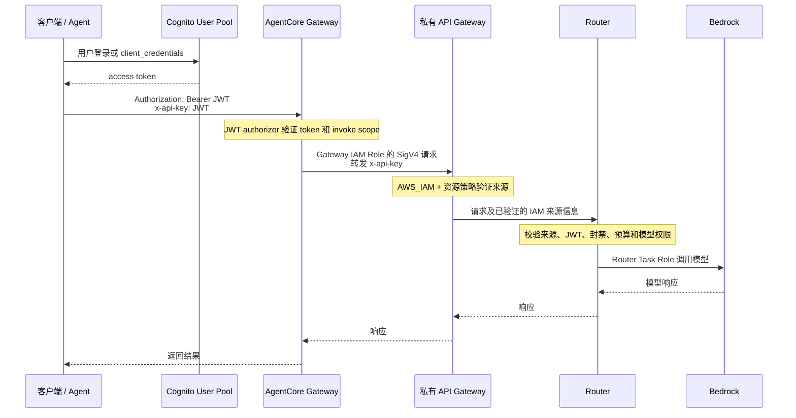

# Gateway 认证与 Cognito User Pool 集成

本文依据 2026-11-23 的仓库实现说明认证链路。线上实际配置，尤其是 `identity.mode`，可能被控制台覆盖；本文不代表一次线上配置审计。

当前仓库已经集成了 **Cognito User Pool**。整体认证链路是：**Cognito 签发 access token → AgentCore Gateway 验证 JWT → Gateway 用 IAM 身份调用私有后端 → router 再验证调用者身份并执行访问限制**。

## 1. 完整请求链路



这里有两种不同身份：

- **用户或服务身份**：来自 Cognito token，决定调用归属、预算和模型访问权限。
- **AWS 服务身份**：Gateway Role 负责调用后端 API，Router Task Role 负责调用 Bedrock。

调用者无需获得直接调用 Bedrock 的 AWS 凭证。

## 2. Cognito User Pool 和 App Client 配置

[RouterStack](../../infra/src/stack.ts) 会创建 User Pool、Cognito 登录域名和 Resource Server。

Resource Server 的 identifier 是部署的 `<prefix>`，定义两个 scope：

| Scope | 用途 |
|---|---|
| `<prefix>/invoke` | 调用模型 Gateway，默认是 `llmar/invoke` |
| `<prefix>/console` | 调用管理控制台 API |

同一个 User Pool 下有几类 App Client：

| App Client | OAuth 流程 | Client Secret | 权限与有效期 |
|---|---|---|---|
| `agent-m2m`，以及控制台创建的服务客户端 | `client_credentials` | 有 | `invoke`；默认 agent access token 为 60 分钟 |
| `cli` | Authorization Code + PKCE | 无 | `openid`、`invoke`；access token 60 分钟，refresh token 默认 30 天 |
| `console` | Authorization Code + PKCE | 无 | `openid`、`email`、`console`；access token 15 分钟，refresh token 8 小时 |

CLI 和 Console 都启用了 refresh token rotation。

当前 User Pool 关闭自助注册，通过管理员邀请成员；密码至少 14 位，并要求大小写、数字和符号。**MFA 默认未启用**。

## 3. Gateway 如何信任 Cognito

核心配置在 [Gateway 定义](../../infra/src/stack.ts) 中。以下省略了资源名称、角色等字段，并用 `region`、`userPoolId`、`prefix` 表示部署值：

```typescript
authorizerType: 'CUSTOM_JWT',
authorizerConfiguration: {
  customJwtAuthorizer: {
    discoveryUrl:
      `https://cognito-idp.${region}.amazonaws.com/${userPoolId}/.well-known/openid-configuration`,
    allowedScopes: [`${prefix}/invoke`],
  },
}
```

`discoveryUrl` 指向 **User Pool 的 OIDC 元数据地址**。Gateway 通过它获得 issuer、签名公钥等信息，验证传入 JWT 的签名及有效性，并要求 token 包含 `invoke` scope。

这意味着：

- Gateway 不需要保存用户密码或 App Client Secret。
- Client Secret 用于服务客户端向 Cognito 换取 token。
- 公钥用于 Gateway 验证 Cognito 签发的 token。

**当前采用 scope 限制，没有配置 `allowedClients` 或 `allowedAudience`。** 因此，同一 User Pool 下，管理员授予了 `invoke` scope 的客户端可以调用 Gateway；新增服务客户端无需再修改 Gateway 的 client ID 白名单。Console Client 没有 `invoke` scope，所以其 token 无法用于模型调用。

Discovery URL 的主机是 `cognito-idp`；浏览器登录和换 token 使用的是 Cognito 登录域名，两者用途不同。

## 4. 为什么 token 要放在两个请求头里

客户端通常发送：

```http
Authorization: Bearer <access_token>
x-api-key: <access_token>
```

两个头分别承担不同职责：

| 请求头 | 谁使用 | 用途 |
|---|---|---|
| `Authorization` | AgentCore Gateway | 验证调用模型入口的资格 |
| `x-api-key` | Router | 验证最终调用者，并执行按调用者设置的限制 |

Gateway 调用后端时使用自己的 **SigV4 Authorization**。因此，项目把 Cognito token 额外放进 `x-api-key`，并将它加入允许转发的请求头列表 `REQUEST_HEADERS`。

这里的 `x-api-key` 实际承载的是 **Cognito access token**。Router 接受原始 JWT，也接受带 `Bearer ` 前缀的值。

两次 JWT 校验独立完成；router 以 `x-api-key` 中验证出的身份作为请求归属。

## 5. Router 的验证和访问限制

### 5.1 后端请求来源验证

Router 首先检查请求是否通过预期 Gateway 到达，包括 Gateway Role、VPC Endpoint 和 Gateway ARN。私有 API Gateway 使用 `AWS_IAM`，并将验证后的来源信息写入后端请求头、覆盖客户端提供的同名值。

实现见 [inbound.ts 的 createInboundCheck](../../packages/router/src/inbound.ts)，相关字段包括：

- `x-router-caller-arn`：API Gateway 验证后的 IAM 调用者。
- `x-router-source-vpce`：请求经过的 VPC Endpoint。
- `x-amz-source-arn`：预期的 AgentCore Gateway ARN。
- `x-amz-source-account`：存在时必须匹配预期账户。

Target 创建或更新时的模型发现请求 `GET /v1/models` 可以没有 `x-amz-source-arn`，但仍要求正确的 Gateway Role 和 VPC Endpoint。模型推理请求使用严格的 Gateway ARN 检查。

### 5.2 Cognito access token 验证

[identity.ts 的 createVerifier](../../packages/router/src/identity.ts) 校验：

- JWT 格式、`alg = RS256`、`kid` 和签名。
- `iss` 必须匹配配置的 User Pool。
- `token_use` 必须是 `access`。
- `exp`，以及存在时的 `iat`、`nbf`。
- `scope` 必须包含 `<prefix>/invoke`。
- `sub`、`client_id` 的格式。

因此，调用模型应发送 **access token**。ID token 用于表达登录身份，refresh token 用于换取新 token。

Router 将身份归为：

- 用户 token：`user:<sub>`。
- M2M token：当没有 `username` 且 `sub == client_id` 时，归为 `client:<client_id>`。

当前 verifier 检查 `client_id` 格式，没有额外维护 client ID 白名单。

### 5.3 公钥同步和缓存

签名公钥通过以下链路同步：

```text
Cognito JWKS
    → jwks-sync Lambda，每 5 分钟
    → S3 identity/jwks.json
    → Router，每 30 秒轮询
```

JWKS 地址为：

```text
https://cognito-idp.<region>.amazonaws.com/<userPoolId>/.well-known/jwks.json
```

Router 在请求期间使用本地公钥，验证成功的 token 也有缓存。公钥集合发生变化时，verifier 清空 token 验证缓存。每次请求仍会检查封禁和预算状态。

### 5.4 Identity mode

[identity.ts 的 createIdentityGate](../../packages/router/src/identity.ts) 有三个模式：

| 模式 | 缺失或无效的 `x-api-key` | 有效身份的封禁、预算限制 |
|---|---|---|
| `off` | 放行，不解析身份 | 不执行身份 gate |
| `observe` | 放行，记录为无身份 | 执行 |
| `require` | 返回 401 | 执行 |

**部署默认是 `observe`。** 所以缺失或无效的第二份 token，可以让请求失去身份归属，并绕过按调用者设置的预算等限制。若要让这些限制覆盖每次模型调用，需要启用 `require`；这不会改变 Gateway 自身的 JWT 验证。

部署默认值来自 `-c identityMode`，并传入 `ROUTER_IDENTITY_MODE`。运行时配置 `config/active.json` 中的 `identity.mode` 优先于环境变量，因此确认实际行为时应查看当前生效配置。

Router 的封禁返回 403，预算耗尽返回 429。封禁通过配置文件传播，通常需等待轮询生效。仅撤销 Cognito 登录会话，也不能让本地 JWT 验证立即识别所有尚未过期的 access token，因此项目另有应用侧封禁机制。

所有模型请求都经过 router，且没有绕过其身份检查的 fallback target。Router 在身份检查通过后，继续按有效配置执行调用者的模型档位和 pin 权限限制。

## 6. 管理控制台如何集成同一个 User Pool

控制台使用单独的 App Client 和 API 认证链路：

```text
浏览器
  → Cognito Managed Login，Code + PKCE
  → Console access token
  → HTTP API JWT Authorizer
  → console-api Lambda
```

[ConsoleStack](../../infra/src/console-stack.ts) 配置了：

- issuer：同一个 User Pool。
- audience：Console Client ID。
- route scope：`<prefix>/console`。

Lambda 进一步要求用户 access token，并检查 `cognito:groups` 中的 `admin` / `member`。随后每次请求都会读取 DynamoDB 中的成员记录，确认账户仍启用、角色仍有效，避免旧 token 中的管理员 group 在降权后继续赋予管理员权限。

实现见 [console-api/auth.ts 的 callerOf 和 authorize](../../packages/console-api/src/auth.ts)。M2M token 不能用来登录管理控制台。

浏览器登录由 [user-manager.ts](../../packages/console-web/src/auth/user-manager.ts) 使用 `oidc-client-ts` 实现。Token 默认存储在 `sessionStorage`，也支持内存存储；刷新在 API 调用前按需执行，并发调用共享刷新操作。

## 7. 实际接入方法

### 7.1 成员登录和调用

对于当前部署，成员可以使用已有的 CLI：

```bash
llmar configure --from '{
  "cognitoDomain": "https://<domain>.auth.<region>.amazoncognito.com",
  "clientId": "<CliClientId>",
  "scope": "<prefix>/invoke",
  "redirectPorts": [52817, 52818, 52819],
  "gatewayUrl": "<GatewayUrl>"
}'

llmar login
```

`llmar login` 打开 Cognito 登录页，通过 PKCE 换取 token；之后 `llmar-token` 返回缓存或刷新后的 access token。配置值来自控制台 Get started 页面或 CloudFormation 输出。

CLI 默认的 loopback callback 是 `http://127.0.0.1:<port>/callback`，端口必须与 App Client 注册值一致。上面的端口对应默认 `cliRedirectPorts`。详细说明见 [llmar README](../../tools/llmar/README.md)。

将 `GW` 设置为部署的 `GatewayUrl` 后，调用示例为：

```bash
TOKEN="$(llmar-token)"

curl "$GW/inference/v1/messages" \
  -H "Authorization: Bearer $TOKEN" \
  -H "x-api-key: $TOKEN" \
  -H "Content-Type: application/json" \
  -H "anthropic-version: 2023-06-01" \
  -d '{
    "model": "auto",
    "max_tokens": 128,
    "messages": [{"role": "user", "content": "你好"}]
  }'
```

模型 API 的路径为：

| API | 请求 URL |
|---|---|
| Anthropic Messages | `<GatewayUrl>/inference/v1/messages` |
| OpenAI Chat Completions | `<GatewayUrl>/inference/v1/chat/completions` |
| OpenAI Responses | `<GatewayUrl>/inference/v1/responses` |

### 7.2 服务客户端

服务客户端向 Cognito 域名的 `/oauth2/token` 发送 `grant_type=client_credentials`，用 Client ID 和 Secret 认证，请求 `<prefix>/invoke` scope，再将返回的 access token 放入 `Authorization` 和 `x-api-key` 两个头中。

管理员可以通过控制台的 Service clients 页面创建客户端。Secret 应保存在受控的凭证存储中；长时间运行的任务应缓存 access token，避免每个模型请求都重新向 Cognito 申请 token。

### 7.3 接入已有的 Cognito User Pool

当前 CDK 会新建 User Pool，没有现成的“传入已有 User Pool ID”部署参数。如果要接入已有 Pool，需要调整基础设施代码，确保以下配置一致：

| 配置位置 | 需要指向或匹配的值 |
|---|---|
| Gateway JWT authorizer | 现有 Pool 的 OIDC discovery URL |
| Router `ROUTER_IDENTITY_ISSUER` | 现有 Pool 的 issuer |
| jwks-sync Lambda | 现有 Pool 的 JWKS URL |
| Resource Server | `<prefix>/invoke` 和 `<prefix>/console` scope |
| CLI、服务和 Console App Client | 对应的 OAuth flow、scope、token 配置 |
| 登录 callback / logout URL | 实际 CLI loopback 和 Console URL |
| Console Pool 引用及 IAM 权限 | 现有 Pool ID 和 ARN |
| Console 成员和权限数据 | 现有用户的 `sub`、group 和成员记录 |

已有用户能在 Cognito 登录，不代表自动拥有控制台成员权限；控制台仍要求有效的成员记录。

这里只调用自己的 Gateway/API 时，无需额外创建 Cognito Identity Pool。

## 8. 相关资料

- [项目客户端接入说明](../../README.md#connecting-clients)
- [基础设施说明](../../infra/README.md)
- [管理控制台说明](../console/README.zh-CN.md)
- [AWS：创建 AgentCore Gateway 的 authorizer 配置](https://docs.aws.amazon.com/bedrock-agentcore/latest/devguide/gateway-create-api.html)
- [AWS：验证 Cognito JWT](https://docs.aws.amazon.com/cognito/latest/developerguide/amazon-cognito-user-pools-using-tokens-verifying-a-jwt.html)
- [AWS：HTTP API JWT authorizer](https://docs.aws.amazon.com/apigateway/latest/developerguide/http-api-jwt-authorizer.html)
