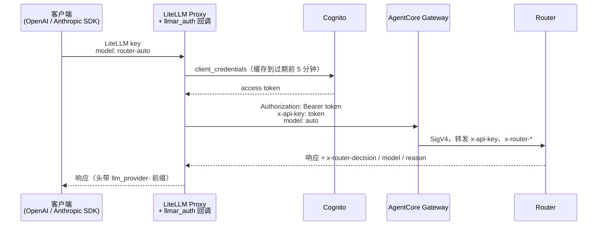

# 通过 LiteLLM Proxy 接入

本文说明如何把 LLM Agentic Auto Router 接在 [LiteLLM Proxy](https://docs.litellm.ai/docs/simple_proxy) 后面：客户端仍然连接 LiteLLM，LiteLLM 再把请求转发给 router，由 router 选择模型。

本文内容在 2026-11-26 用 LiteLLM 1.111.0 对一套线上部署实测过，结果见[第 8 节](#8-已验证的范围)。

## 1. 链路



LiteLLM 对 router 来说就是一个[服务客户端](../../README.md#service-clients-ci-and-agents)：

- LiteLLM 用 client_credentials 取 token，同一个 token 同时放进两个头：`Authorization` 交给 Gateway 验证，`x-api-key` 交给 router 验证并记录调用者身份（原因见[认证文档 §4](../auth/gateway-cognito-auth.zh-CN.md)）。
- 客户端只持有 LiteLLM 的 key，拿不到 router 的 token。
- 发给 router 的模型名是 `auto` 或 `auto:fast` 这类别名。LiteLLM 的 `model_name` 只是 LiteLLM 内部的名字，可以随意取。

## 2. 准备

| 需要的值 | 从哪里来 |
|---|---|
| `GatewayUrl` | router 栈（`<prefix>-router`）的 CloudFormation 输出，或控制台 Get started 页面 |
| `TokenEndpoint` | 同上 |
| 服务客户端 ID 和 Secret | 管理员在控制台 Service clients 页面创建；Secret 只显示一次，存进 Secrets Manager |
| Scope | `<prefix>/invoke` |

为 LiteLLM 单独建一个服务客户端，不要和 CI 或其他 agent 共用，这样控制台里 LiteLLM 的用量、预算和封禁是独立的。

## 3. 文件

仓库里的 [`tools/litellm/`](../../tools/litellm/) 有两个文件：

| 文件 | 作用 |
|---|---|
| [`llmar_auth.py`](../../tools/litellm/llmar_auth.py) | LiteLLM 回调。每次调用 router 前注入有效 token，过期前 5 分钟自动刷新 |
| [`config.example.yaml`](../../tools/litellm/config.example.yaml) | 示例配置：三个模型、加载回调、转发 `x-router-*` 头。文件里没有任何密钥 |

`llmar_auth.py` 用的是 LiteLLM 的 `async_pre_call_deployment_hook`。它只处理 `api_base` 以 `LLMAR_GATEWAY_URL` 开头的 deployment，其他模型不受影响。对这些 deployment，它：

1. 取 token。token 缓存在内存里，过期前 5 分钟才重新申请，并发请求共用同一次申请；
2. 删掉客户端转发来的、或配置里写的 `Authorization` 和 `x-api-key`，避免客户端用来访问 LiteLLM 的 key 被转发到上游；
3. 把 token 同时写入 `Authorization: Bearer` 和 `x-api-key`。

模型配置：

```yaml
model_list:
  - model_name: router-auto            # OpenAI 方言：/v1/chat/completions、/v1/responses
    litellm_params: {model: openai/auto, api_base: os.environ/LLMAR_OPENAI_BASE, api_key: set-by-llmar-auth}
  - model_name: router-auto-fast       # 对应 router 的 auto:fast 别名
    litellm_params: {model: openai/auto:fast, api_base: os.environ/LLMAR_OPENAI_BASE, api_key: set-by-llmar-auth}
  - model_name: router-auto-claude     # Anthropic 方言：/v1/messages
    litellm_params: {model: anthropic/auto, api_base: os.environ/LLMAR_ANTHROPIC_BASE, api_key: set-by-llmar-auth}
```

`api_key` 只是占位符，回调会把它替换成 token。注意两种方言的 `api_base` 不同：

| LiteLLM provider | `api_base` | LiteLLM 实际请求的 router 路径 |
|---|---|---|
| `openai/…` | `<GatewayUrl>/inference/v1` | `/inference/v1/chat/completions`、`/inference/v1/responses` |
| `anthropic/…` | `<GatewayUrl>/inference` | `/inference/v1/messages` |

## 4. 启动

```bash
pip install 'litellm[proxy]'     # 实测版本 1.111.0

GW=<GatewayUrl>
export LLMAR_GATEWAY_URL=$GW
export LLMAR_OPENAI_BASE=$GW/inference/v1
export LLMAR_ANTHROPIC_BASE=$GW/inference
export LLMAR_TOKEN_ENDPOINT=<TokenEndpoint>
export LLMAR_SCOPE=<prefix>/invoke
export LITELLM_MASTER_KEY=sk-<随机生成的长字符串>

# 从 Secrets Manager 读取服务客户端，示例 secret 为 {"client_id": …, "client_secret": …}
S=$(aws secretsmanager get-secret-value --secret-id <secret-id> --query SecretString --output text)
export LLMAR_CLIENT_ID=$(jq -r .client_id <<<"$S") LLMAR_CLIENT_SECRET=$(jq -r .client_secret <<<"$S")
unset S

cd tools/litellm
litellm --config config.example.yaml --host 127.0.0.1 --port 4000
```

LiteLLM 会从配置文件所在目录加载 `llmar_auth.py`，所以两个文件要放在同一目录。

**网络暴露。** 上面的命令只监听 `127.0.0.1`。如果要让其他机器访问这个 LiteLLM，需要先在 LiteLLM 侧为每个用户或团队发放 [virtual key](https://docs.litellm.ai/docs/proxy/virtual_keys)，不要共用 master key；前面放 TLS；只对需要的网络开放端口。这个 LiteLLM 持有的服务客户端可以调用 router，任何能访问 LiteLLM 的人就相当于持有了 router 的调用权限。

## 5. 客户端怎么调用

客户端连 LiteLLM，用 LiteLLM 的 key，模型名用 LiteLLM 配置里的 `model_name`。

OpenAI SDK：

```python
from openai import OpenAI
c = OpenAI(base_url="http://127.0.0.1:4000/v1", api_key="<LiteLLM key>")
r = c.chat.completions.with_raw_response.create(
    model="router-auto",
    messages=[{"role": "user", "content": "你好"}],
    extra_headers={"x-router-session": "my-task-42"},   # 可选，见第 6 节
)
print(r.headers.get("llm_provider-x-router-model"), r.parse().choices[0].message.content)
```

Anthropic SDK：

```python
import anthropic
c = anthropic.Anthropic(base_url="http://127.0.0.1:4000", api_key="<LiteLLM key>")
m = c.messages.create(model="router-auto-claude", max_tokens=256,
                      messages=[{"role": "user", "content": "你好"}])
```

**让客户端方言和 router 方言一致。** OpenAI 格式的客户端用 `router-auto`，Anthropic 格式的客户端用 `router-auto-claude`。LiteLLM 也能做方言转换（比如 Anthropic SDK 请求 `router-auto`），实测可以跑通，但转换后请求体会改变，router 看到的不再是客户端的原始请求，prompt cache 和工具调用格式都可能受影响。

## 6. 会话、路由提示和响应头

`general_settings.forward_client_headers_to_llm_api: true` 会让 LiteLLM 把客户端发来的 `x-*` 头（`x-stainless-*` 除外）转发到上游，router 的请求头因此可以原样透传：

| 头 | 作用 |
|---|---|
| `x-router-session` | 指定会话 ID。实测中，两个内容无关的首条消息带同一个 ID，router 把它们归入同一会话（第一条 `initialize`，第二条 `retain`） |
| `x-router-hint` | 路由提示，比如 `pin=<model>` |

没有开启这个开关时，router 只能从请求内容推断会话。

router 返回的 `x-router-decision`、`x-router-model`、`x-router-reason`，在 LiteLLM 的 OpenAI 方言端点（`/v1/chat/completions`、`/v1/responses`）上会以 `llm_provider-x-router-…` 的名字返回给客户端。LiteLLM 的 `/v1/messages` 端点不会返回这些头，要看路由决策只能查 router 日志（第 9 节）。

## 7. 身份、预算和 `require` 模式

router 看到的调用者是 LiteLLM 使用的那个服务客户端：

- 控制台里，所有经过 LiteLLM 的用量都记在这个服务客户端名下，不区分 LiteLLM 后面的终端用户；
- 在 router 侧给这个服务客户端设置的预算、档位限制和封禁，作用于经过 LiteLLM 的全部流量；
- 按终端用户或团队的预算和限流，要用 LiteLLM 自己的 virtual key 和 team 来做。

因为回调每次都会写入 `x-api-key`，router 的 `identity.mode` 设为 `require` 时 LiteLLM 也能正常调用。实测中所有请求的 router 日志都是 `identity: verified`。

## 8. 已验证的范围

2026-11-26，LiteLLM 1.111.0，线上部署，回调模式：

| 客户端 → LiteLLM | router 方言 | 结果 |
|---|---|---|
| OpenAI SDK chat.completions，非流式和流式 | openai-chat | 通过，router 决定模型（gpt-6.1-sol / gpt-6-luna），返回 `llm_provider-x-router-*` |
| OpenAI SDK，`auto:fast` 别名 | openai-chat | 通过，router 日志里 `requested: auto:fast` |
| OpenAI SDK，function tools | openai-chat | 需要 `reasoning_effort: "none"`，见第 10 节 |
| OpenAI SDK responses | openai-responses | 通过 |
| Anthropic SDK messages，非流式、流式、tool_use 两轮 | anthropic-messages | 通过（Sonnet 5.5 / Haiku 5.5），工具循环被 router 正确锁定为 `hard-lock-tool-loop` |
| Anthropic SDK → `router-auto`（LiteLLM 转换方言） | openai-chat | 通过 |
| 多轮对话，带 `x-router-session` | — | 通过，会话保持 |
| token 缓存与刷新（单元级） | — | 通过：未到刷新时间时复用缓存；距过期不到 5 分钟时重新申请；非 router 的 deployment 不受影响；客户端带来的 `x-api-key` 不会转发 |

未验证：通过 LiteLLM 接入 Claude Code、Codex 等 agent 客户端；LiteLLM 的 `/anthropic` pass-through 端点；LiteLLM 的 fallback 和负载均衡与 router 的交互。

## 9. 验证接入

1. 发一条 OpenAI 方言请求，确认响应头里有 `llm_provider-x-router-model`；
2. 查 router 日志（日志组 `/<prefix>/router`），确认这些请求的 `identity` 是 `verified`，`principal.id` 是 LiteLLM 的服务客户端：

```bash
aws logs filter-log-events --log-group-name /<prefix>/router \
  --start-time $(( ($(date +%s) - 600) * 1000 )) \
  --filter-pattern '{ $.kind = "model" }' --query 'events[].message' --output text
```

也可以在控制台里查看这个服务客户端的用量。

## 10. 已知问题与排查

| 现象 | 原因 | 处理 |
|---|---|---|
| 400 `Function tools with reasoning_effort are not supported for gpt-6-luna in /v1/chat/completions` | router 把带 function tools 的 Chat Completions 请求路由到了 gpt-6-luna，Bedrock 不支持这个模型在 Chat Completions 上同时使用 tools 和默认推理强度。这是 router 的问题，不经过 LiteLLM 直连 Gateway 也会出现 | 客户端请求加 `reasoning_effort: "none"`，或者改用 `/v1/responses` |
| 401，响应里没有 `x-router-*` 头（被 Gateway 拒绝） | token 无效、过期，或者 scope 不是 `<prefix>/invoke` | 检查 `LLMAR_TOKEN_ENDPOINT`、`LLMAR_SCOPE` 和服务客户端是否仍然有效 |
| router 日志 `identity: missing`；`require` 模式下返回 401 `identity-missing` | 没有发送 `x-api-key`。不用回调、手写 `extra_headers` 时，`anthropic/` provider 需要同时显式写 `Authorization` 和 `x-api-key`，否则 `x-api-key` 发不出去 | 使用 `llmar_auth.py` |
| 不用回调时，约 60 分钟后全部 401 | 配置里写死的 token 过期了，LiteLLM 不会刷新 | 使用 `llmar_auth.py` |
| 设置了 `x-router-session`，会话没有保持 | 没有开启 `forward_client_headers_to_llm_api` | 开启这个开关（第 6 节） |
| `/v1/messages` 响应里没有 router 头 | LiteLLM 的 `/v1/messages` 端点不返回上游响应头 | 查 router 日志 |
